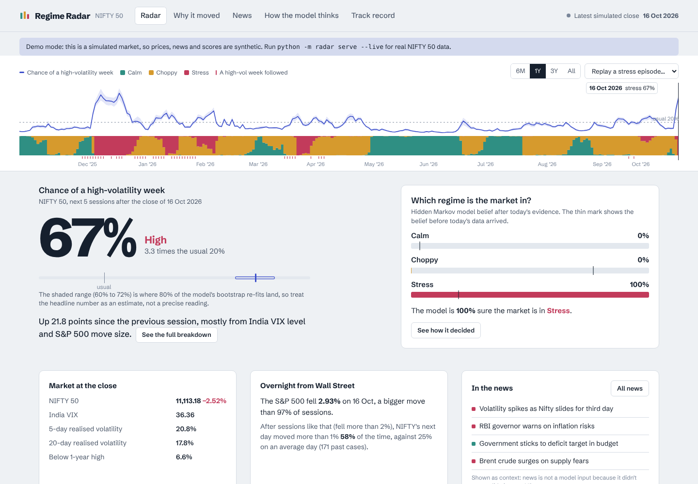
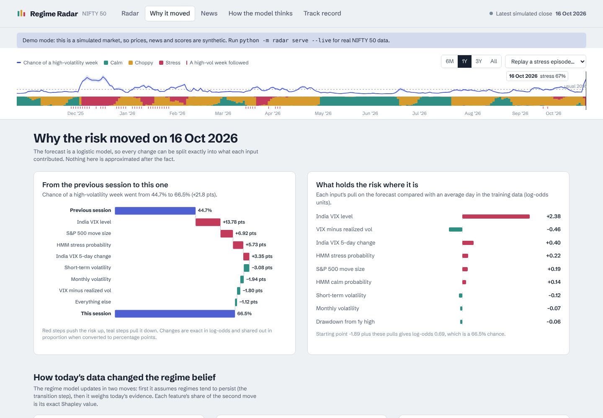
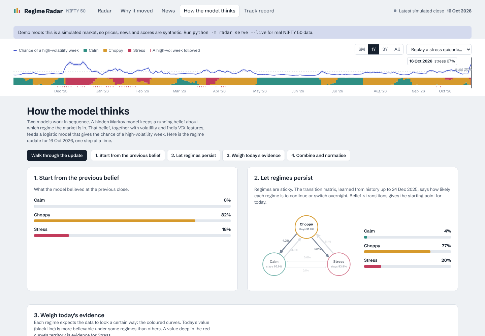
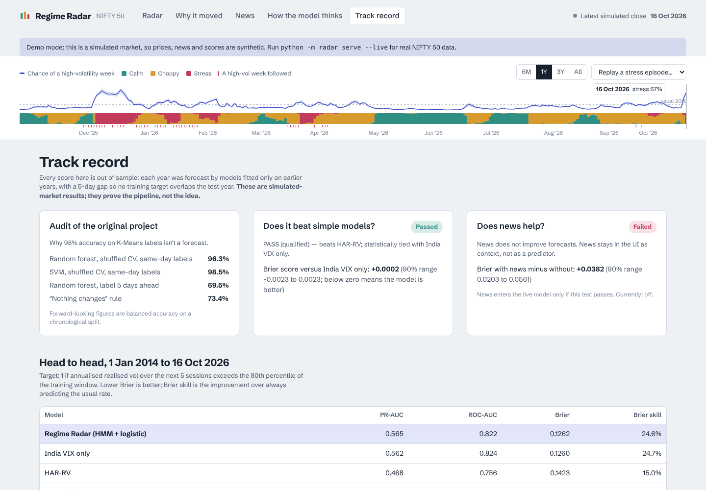
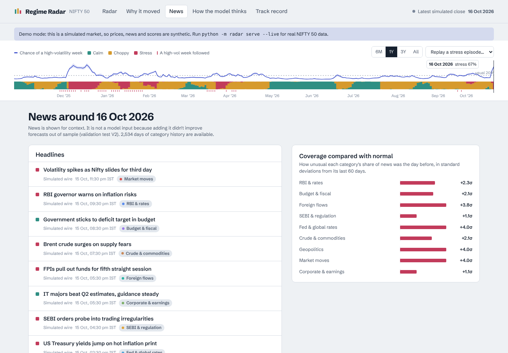

# Regime Radar

**An explainable market-risk radar for the NIFTY 50.** It estimates the chance that the next five sessions will be a high-volatility week, shows which market regime it thinks India is in, and explains every change down to the individual input, live.

It does **not** predict direction or recommend trades. That's deliberate: see [Why risk, not direction](#why-risk-not-direction).



| Why it moved | How the model thinks |
|---|---|
|  |  |
| **Track record** | **News** |
|  |  |

> Screenshots are from demo mode (a built-in simulated market). Run it with `--live` for real NIFTY 50 data.

---

## What it does

| Screen | What you see |
|---|---|
| **Radar** | Chance of a high-volatility week with an 80% uncertainty range, the regime belief (Calm / Choppy / Stress), market stats, the overnight S&P 500 bridge, headlines, and "second opinions" from simpler models |
| **Why it moved** | Exact waterfall of the day-over-day change, each input's pull on today's level, and the regime update split into persistence + per-feature Shapley values |
| **How the model thinks** | A step-through of the hidden Markov model's forward algorithm: previous belief → transition matrix → each regime's expected distribution vs today's value → normalised belief. Then the logistic model's weights |
| **News** | Tagged headlines (RBI, budget, FII flows, SEBI, Fed, crude, geopolitics, market moves, earnings), coverage surprise by category, 60-day heatmap, and an event study of what followed past surprises |
| **Track record** | The validation gates (V0/V1/V2), head-to-head scores against baselines, calibration, year-by-year results, and an append-only ledger of live forecasts scored automatically |

The **belief ribbon** at the top is also the time machine: drag it, use the arrow keys, or pick a past stress episode and press play to watch the model's belief evolve day by day, with "what actually happened" revealed for each date.

## Quick start

Needs Python 3.10+ and Node 18+.

```bash
git clone https://github.com/Sharank874/regime-radar.git
cd regime-radar
pip install -r requirements.txt
cd web && npm install && npm run build && cd ..

python -m radar demo            # simulated market, no internet needed → http://127.0.0.1:8000
```

With real data:

```bash
python -m radar fetch           # NIFTY 50, India VIX, S&P 500, VIX from Yahoo Finance
python -m radar news-backfill   # daily GDELT news timelines since 2017 (~15–20 min the first time)
python -m radar validate --live # run V0/V1/V2 on real data → reports/validation.md
python -m radar serve --live    # the app, with live updates during NSE hours
```

The first start fits the walk-forward models (about a minute); fitted folds are cached in `data/cache/`, so later starts are fast.

Or use `make demo`, `make live`, `make validate`, `make test`.

### Live mode, in practice

- **During NSE hours (09:15–15:40 IST)** the server pulls a delayed 5-minute NIFTY and India VIX print every 5 minutes and pushes a **provisional** nowcast over a WebSocket. The UI labels it as provisional.
- **Every 15 minutes** it collects headlines from GDELT and RSS feeds (RBI, ET Markets, Moneycontrol, Livemint).
- **After 16:00 IST** it refreshes daily data, updates news timelines, rebuilds, and records the day's forecast in the ledger. Forecasts are scored automatically five sessions later.

"Real time" here means minutes, not milliseconds. That is fine for risk monitoring and useless for trading, and the app says so.

## How it works

```
Yahoo Finance (NIFTY, India VIX, S&P 500, VIX) ─┐
GDELT DOC 2.0 timelines + articles, RSS ────────┤
                                                ▼
                     leakage-safe features (radar/features.py)
                                                ▼
     Gaussian HMM, filtered only ──► regime belief + exact Shapley attribution
                                                ▼
     logistic model (+ bootstrap band) ──► P(high-vol week) + exact contributions
                                                ▼
     walk-forward by year, purged ──► validation V0/V1/V2 ──► ledger
                                                ▼
                    FastAPI + WebSocket ──► React app (or static GitHub Pages build)
```

**Target.** 1 if NIFTY's annualised realised volatility over the next 5 sessions exceeds the 80th percentile of the training window. The threshold is set per fold from training data only.

**Regime model.** A 3-state Gaussian HMM written from scratch (`radar/hmm.py`) on daily return, 5-day realised vol, India VIX level and its 5-day change.

- *Diagonal covariance.* This makes each day's evidence a sum over features, which is what allows exact per-feature attribution.
- *Missing features are marginalised out.* So news can join from 2017 without discarding earlier history.
- *Sticky transitions.* A Dirichlet prior on the diagonal keeps regimes persistent.
- *Tempered likelihood.* Evidence is down-weighted by K_eff/K, computed from the feature correlation matrix, so correlated features (volatility and VIX) aren't double-counted.
- *Forward filter only.* Only the forward filter is ever displayed or evaluated. Smoothing would leak the future into past beliefs.

**Forecast model.** Regularised logistic regression on the HMM belief plus volatility, India VIX, drawdown, momentum and overnight S&P features.

- *Why logistic.* Gradient boosting is fitted on the same features for comparison, but the logistic model is used because its contributions are exact.
- *Uncertainty band.* The range comes from 25 block-bootstrap refits.

**Baselines.** Base rate, India VIX alone, HAR-RV (log realised vol at 1/5/22 days), and GARCH(1,1) refitted per fold.

**Walk-forward.** For each test year Y, every model is fitted on data before Y, with a 5-session purge so no training target overlaps the test year. Every reported score is out of sample.

## Validation gates

| Gate | Question | Pass rule |
|---|---|---|
| **V0** | Was the original project's ~98% SVM / Random Forest accuracy a forecast? | Compare shuffled-CV accuracy on same-day K-Means labels with predicting the label 5 days ahead on a chronological split, against a "nothing changes" rule |
| **V1** | Does the model beat simple models? | Brier score vs HAR-RV, GARCH and India VIX, with 90% block-bootstrap intervals |
| **V2** | Does news add skill? | News model minus price-only model Brier interval must exclude zero. **News enters the production model only if V2 passes**; otherwise it stays in the UI as context |

On the simulated market (which only proves the pipeline works), V0 reproduces the original problem:

- *Same-day labels, shuffled CV.* SVM scores 98.5%, close to the original project's figure.
- *Predicting 5 days ahead, chronological split.* Random forest balanced accuracy drops to 69.5%.
- *Naive baseline.* The "nothing changes" rule scores 73.4%, beating the random forest.

### Results on real data (NIFTY 50, 2014 → Oct 2026)

From `reports/validation.md`, generated with Yahoo Finance data downloaded on 18 Oct 2026. Every score is walk-forward and out of sample.

**V0: the original project's accuracy was not a forecast.**

| Test | Accuracy |
|---|---:|
| SVM, shuffled CV on same-day K-Means labels | 99.0% |
| Random forest, shuffled CV on same-day labels | 97.7% |
| Random forest, label 5 days ahead, chronological split | 78.7% (balanced 77.5%) |
| "Nothing changes" rule | 78.5% (balanced 78.1%) |

**V1: PASS.** The model beats every baseline, including India VIX:

| Model | PR-AUC | ROC-AUC | Brier | Brier skill |
|---|---:|---:|---:|---:|
| **Regime Radar (HMM + logistic)** | **0.525** | **0.868** | **0.0495** | **0.291** |
| Gradient boosting (same features) | 0.528 | 0.853 | 0.0495 | 0.291 |
| India VIX only | 0.459 | 0.855 | 0.0534 | 0.235 |
| HAR-RV | 0.402 | 0.830 | 0.0584 | 0.163 |
| GARCH(1,1) | 0.410 | 0.827 | 0.0586 | 0.161 |
| Base rate | 0.073 | 0.468 | 0.0853 | −0.222 |

The Brier improvement over India VIX alone is −0.0039, with a 90% block-bootstrap interval of −0.0075 to −0.0011 (negative means the model is better). The edge is real but modest, which is what you should expect against an options-implied volatility index.

**V2: not run yet.** It needs the GDELT news backfill (`python -m radar news-backfill`). Until V2 passes, news stays out of the production model and is shown only as context.

*Reproducibility:* a fresh run of the same data on a clean machine (Python 3.12, Linux) gave identical V1 numbers. The V0 random-forest rows moved by 0.1 percentage points because of tree randomness.

## Why risk, not direction

- **Weak evidence.** The evidence that news predicts index returns is weak and fragile. A FTSE 100 study found Twitter sentiment stopped being a significant return predictor once VIX and other mood measures were controlled for.
- **Small edge.** A 2025 IEEE Access study of FinBERT sentiment for NIFTY next-day returns reported a 5.2% accuracy improvement over baselines.
- **Speed.** Free news arrives in minutes; markets react in milliseconds.
- **Volatility is predictable.** Volatility clusters, and unusual negative news has been linked to higher subsequent volatility.

So the honest, testable product is a risk radar. India VIX is the baseline to beat, because the options market already prices expected volatility.

## Tech stack

Python (NumPy, pandas, scikit-learn, arch) · Gaussian HMM written from scratch · FastAPI + WebSocket · React 19 + TypeScript (Vite) · SQLite ledger · Yahoo Finance and GDELT data · GitHub Actions (CI + Pages) · pytest

## Tests

```bash
make test        # 8 tests: no look-ahead in features or target, causal HMM filter with exact Shapley attribution, missing features, fold boundaries, news parsing and tagging
```

## Project layout

```
radar/
  config.py      every modelling choice, fixed before evaluation
  data.py        Yahoo Finance download + cache + provenance
  simulate.py    regime-switching market simulator (demo mode and tests)
  features.py    leakage-safe features and the forward-vol target
  hmm.py         Gaussian HMM: EM, forward filter, exact Shapley attribution
  pipeline.py    walk-forward folds, classifier, baselines, caching
  validate.py    V0 / V1 / V2 and the markdown report
  news.py        GDELT + RSS ingestion, tagging, event study
  taxonomy.py    India event categories and headline tone lexicon
  ledger.py      append-only prediction ledger (SQLite)
  overnight.py   S&P 500 → NIFTY overnight bridge
  engine.py      assembles all views for the API
  api.py         FastAPI + WebSocket, live loop
  export.py      static export for GitHub Pages
web/             React + TypeScript (Vite) app
tests/           no-look-ahead, exact-attribution and fold-boundary tests
```

## GitHub Pages

`.github/workflows/pages.yml` builds a static, server-free copy of the app (demo data by default) and publishes it.

1. Enable Pages with source "GitHub Actions" in the repository settings.
2. To publish real data, set the repository variable `RADAR_PAGES_MODE=live`. The workflow then fetches Yahoo data on each run, and a weekday schedule after the NSE close keeps it current.

Live nowcasts and the news feed need the Python server.

## Limitations

- Yahoo Finance index data is unofficial and can have gaps; `^NSEI` opening prices are sometimes equal to the previous close, so the overnight bridge uses close-to-close moves.
- GDELT article lists only cover about three months; daily category timelines go back to 2017. Headline tone uses a finance lexicon, not a transformer. A FinBERT tagger is a natural upgrade.
- A diagonal-covariance HMM ignores correlation between features (partly corrected by tempering).
- The regime labels Calm / Choppy / Stress come from ordering states by volatility, not from economic definitions.
- Not investment advice.

## Licence

MIT
